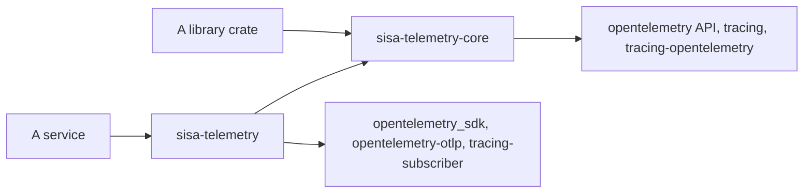
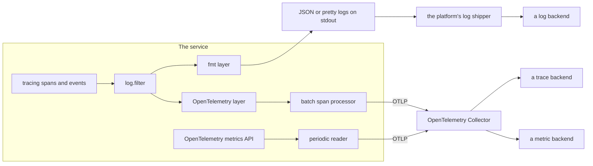

# Architecture

How the crates fit together, as 0.1.0 builds them: the crate map, the signal pipeline, what the
library promises, the rules that hold the design together, and how the OpenTelemetry version is
kept in step. What each crate does is in its [spec](specs/README.md); the headers, names and
settings are in [Formats](formats.md); [Flows](flows.md) draws a message and a request; and the
[decisions](adr/README.md) say why it is this way. The words used everywhere are in the
[docs index](README.md#words-used-everywhere).

## Crates

| Crate and its spec | Published | For | Holds | Depends on |
| --- | --- | --- | --- | --- |
| [`sisa-telemetry-core`](specs/core.md) | yes | Library crates | `propagation`, `record_error`, the meter and duration-histogram helpers, the attribute names; re-exports `opentelemetry` | opentelemetry (the API: trace, metrics), tracing, tracing-opentelemetry |
| [`sisa-telemetry`](specs/telemetry.md) | yes | Applications | `init`, the settings, the guard, the layers, the propagators; re-exports the core | core, tracing-subscriber, opentelemetry_sdk, opentelemetry-otlp |
| `sisa-telemetry`, feature `testing` | yes | Tests in any repository, as a dev-dependency | `testing::capture()`: in-memory exporters to assert on spans and metrics | opentelemetry_sdk's in-memory exporters |

The core has no SDK, no exporter, no broker and no HTTP client. A library that depends on it
never pulls those in, and a breaking change on the SDK side doesn't force that library to
release ([ADR-0006](adr/0006-two-crates-core-and-main.md)). Libraries never depend on
`sisa-telemetry`: it installs global providers, and only the application may do that, once.

How the other sisa crates use the two:

| Repository | `[dependencies]` | `[dev-dependencies]` | What it does with them |
| --- | --- | --- | --- |
| sisa-messaging-rs | `sisa-telemetry-core` | `sisa-telemetry` with `testing` | Publish and consume carry trace headers; tests check the producer link |
| sisa-caching-rs | Nothing new; keeps the `opentelemetry` API it uses | `sisa-telemetry` with `testing` | The example calls `init`; tests check its metrics |
| sisa-health-checks-rs | Nothing new | `sisa-telemetry` with `testing` | The same: the example and the metric tests |
| A service | `sisa-telemetry` | `sisa-telemetry` with `testing` | Calls `init` first thing in `main` |

## Signal pipeline

A service emits `tracing` once. `init` turns it into JSON logs on stdout and OTLP traces and
metrics, and the Collector decides where each signal goes.

The backends are examples: swapping one is a Collector change, not a code change
([ADR-0002](adr/0002-export-over-otlp-to-a-collector.md)). The recommended deployment is
application, OTLP, Collector (batching, memory limiter, tail sampling, attribute redaction),
backends. The Collector is also where redaction rules for personal data live, as a second line
of defense.

## Guarantees and limits

- **Recording never fails and never waits on the network.** Ending a span hands it to the SDK's
  batch span processor with a `try_send` into a queue of 2048 spans (`OTEL_BSP_MAX_QUEUE_SIZE`),
  which a thread of its own exports every 5 seconds or 512 spans. Recording a metric updates
  memory only, and another thread exports every `metrics.interval`.
- **A full queue drops spans.** While the Collector is down or slow, spans past the 2048 are
  dropped: the span that is ending is the one that doesn't get in. The SDK logs the first drop
  and the total at shutdown, not each one.
  Metrics aren't dropped: they are running totals, so the next export that succeeds carries
  them.
- **A failed export is a log line, not an error in the service.** The gRPC exporter retries, then
  the SDK logs the failure at `ERROR` through `tracing`, once per failed batch, so a Collector
  that stays down logs on every export. Nothing counts these yet; a
  `sisa.telemetry.export_failures` counter is on the [roadmap](../ROADMAP.md#not-in-010).
- **Logs on stdout don't depend on the export.** They are written by the fmt layer on the thread
  that logs, and block as any write to stdout does.
- **Only `tracing` events are logged.** `init` installs no bridge from the `log` crate, so a
  dependency that logs through `log` alone prints nothing.
- **`init` succeeds while the Collector is down.** Building an exporter opens no connection; the
  first export does. Tested over gRPC by running the example with no Collector.
- **Without `init`, the core does nothing.** `inject` writes no header, `link_from` and
  `continue_from` set nothing, instruments record into nothing, and nothing panics: a library
  works the same with telemetry off.
- **`init` runs once per process.** A second call fails with `AlreadyInitialized`, after it has
  built and dropped a second set of exporters, and changes nothing that is installed.
- **`shutdown(budget)` can take the budget plus 5 seconds.** The budget is how long it waits for
  the span queue to flush. The metric provider's shutdown ignores the timeout it is given in
  this OpenTelemetry release and waits up to a fixed 5 seconds for one last export. What isn't
  sent by then is lost, and `shutdown` returns `Shutdown`. A dropped guard does the same with a
  budget of 5 seconds, so a drop can block for up to 10.
- **An instrument created before `init` is a no-op for the life of the process**, with no error
  and no log line. `init` comes first in `main`, and `testing::capture()` first in a test.
- **A span's parent can't change once the span has started**, which entering it or calling
  `inject` on it does. `link_from` and `continue_from` then log a warning and leave the span as
  it was: no parent, no link.
- **Sampling follows the caller by default.** With `parentbased_traceidratio`, a span continued
  from a caller that didn't sample its trace isn't exported, whatever `traces.ratio` is.
- **Past `metrics.cardinality_limit` attribute sets**, 2000 by default, an instrument's new sets
  share one point with the attribute `otel.metric.overflow`: the total stays right and the
  attributes of the extra sets are lost.
- **No TLS in 0.1.0.** The exporters are built without it, which suits a Collector beside the
  service. Over gRPC, an `https` endpoint fails `init` with `Exporter`. Over HTTP it is
  untested, and expected to fail at each export rather than at `init`.
- **gRPC needs a Tokio runtime.** `init` with the gRPC protocol, the default, fails with
  `NoRuntime` outside one. The exports then run on that runtime, so they stop when it does.
- **An `OTEL_*` variable with a value the SDK can't use doesn't fall back to the setting.**
  `init` skips its own setting whenever the variable is set, and the SDK then uses its own
  default: `parentbased_always_on` for an unknown `OTEL_TRACES_SAMPLER`, 60 seconds for an
  `OTEL_METRIC_EXPORT_INTERVAL` that isn't a number.

## Rules that hold the design together

1. **`tracing` is the instrumentation API.** Spans and events come from `tracing`, with nothing
   sisa-specific; metrics come from the OpenTelemetry metrics API
   ([ADR-0001](adr/0001-tracing-spans-and-the-opentelemetry-metrics-api.md)).
2. **Only the application installs anything process-wide.** `init` and `testing::capture` set
   the global subscriber, providers and propagators. Nothing else does, and nothing in the core
   does.
3. **The core is API only.** No SDK, no exporter, no broker, no HTTP client: a library adapts
   its own header type to `Injector` and `Extractor`.
4. **Without `init`, nothing happens.** No function of the core writes, logs or panics when no
   provider and no propagator is installed.
5. **One OpenTelemetry minor per binary.** The core pins the API, `sisa-telemetry` pins the SDK
   and the exporters on the same minor, and they move together
   ([Version alignment](#version-alignment)).
6. **A consumed message starts a new trace and links to its producer.** It is never the
   producer's child ([ADR-0007](adr/0007-a-consumed-message-links-to-its-producer.md)). An HTTP
   or gRPC server span is the caller's child.
7. **Unbounded values stay off metrics.** Ids and URLs with ids go on spans and logs. A metric
   attribute takes a small fixed set of values.
8. **The environment wins.** A standard `OTEL_*` variable that is set and not empty wins over
   the setting it matches, so an operator can redirect a service without a new build.
   [Formats](formats.md#settings) lists which variable matches which setting; a setting with no
   variable there has none.
9. **Secrets never show.** A header value from `otlp.headers` reaches no log line, no error and
   no `Debug` output.
10. **Logs go to stdout, on a path that doesn't touch the exporters**
    ([ADR-0003](adr/0003-logs-as-json-on-stdout.md)).

Rules for the spans and metrics a service writes itself are in the
[instrumenting guide](instrumenting.md#rules-for-custom-spans-and-metrics).

## Version alignment

Every sisa crate in one binary must use the same `opentelemetry` minor. Two semver-incompatible
versions are two separate crates with two sets of global providers: a crate on the version the
application didn't initialize records into nothing, with no error.

- The first-party OpenTelemetry crates release together and share one minor;
  `tracing-opentelemetry` pairs with it one number higher. This workspace is on `opentelemetry`
  0.33 and `tracing-opentelemetry` 0.34, the current ones when checked on 2026-11-21.
- The core pins the API for libraries, and `sisa-telemetry` pins the SDK and the exporters and
  re-exports the core. A service depends on neither OpenTelemetry crate directly: it uses
  `sisa_telemetry::opentelemetry`
  ([ADR-0005](adr/0005-one-place-pins-the-opentelemetry-version.md)).
- An OpenTelemetry upgrade is one coordinated change: sisa-telemetry first, then each repository
  bumps `opentelemetry` and releases. Dependabot groups the OpenTelemetry crates into one PR.
- CI fails when the build holds two versions:
  `cargo tree -i opentelemetry --all-features --edges normal > /dev/null` errors when the name
  is ambiguous. Each sisa repository runs the same check.
- The examples in each repository use `sisa-telemetry`, so the check covers the version a
  service gets too.

## Decisions

Settled; reopen only with new evidence. Each one is an [ADR](adr/README.md), with its context and
the alternatives it was chosen over.
