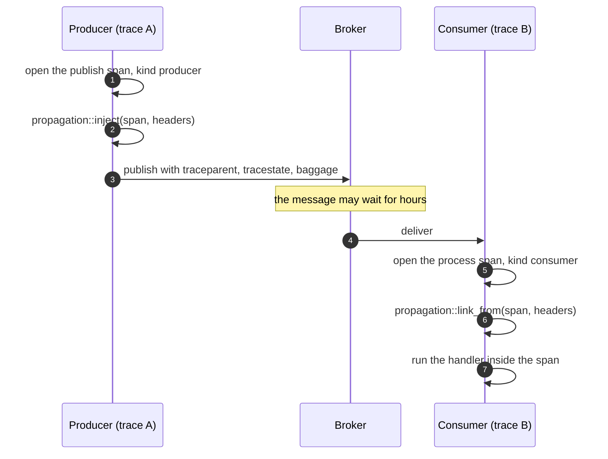
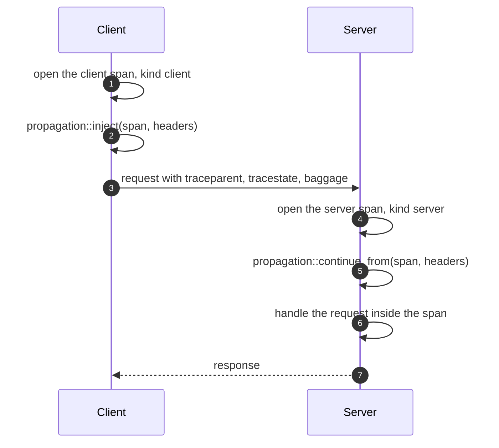

# Flows

Diagrams of trace context crossing a process boundary, which the
[core spec](specs/core.md#behaviour) describes. A new flow follows
[templates/flow-spec.md](templates/flow-spec.md).

## A message from producer to consumer

Status: **Implemented** in 0.1.0 · Crates: [core](specs/core.md), [telemetry](specs/telemetry.md)

A message carries its producer's trace context, and the consumer's span starts a new trace that
links back to it.

- Step 2 writes nothing when no propagator is installed: the message goes out without trace
  headers, and messaging works the same.
- Step 7 makes the span the root of a new trace, adds one link to the producer's span, and keeps
  the baggage. Headers with no trace context add no link.
- Step 7 comes before step 8: once the span is entered its parent is fixed.
- The consumer opens one span per message, never one around its poll loop.
- The consumer's span also carries `sisa.correlation_id` from the message, so a business flow can
  be found across traces even though each message is its own trace.

Why a link and not a parent: [ADR-0007](adr/0007-a-consumed-message-links-to-its-producer.md).

## A request from client to server

Status: **Implemented** in 0.1.0 · Crates: [core](specs/core.md)

An HTTP or gRPC call is one trace: the server's span is the client's child.

- Step 5 makes the caller's span the parent, with the caller's sampling decision, which the
  default sampler respects. Headers with no trace context leave the span as it is.
- A reqwest middleware and an axum layer that do steps 2 and 5 are planned for 0.2.0.
